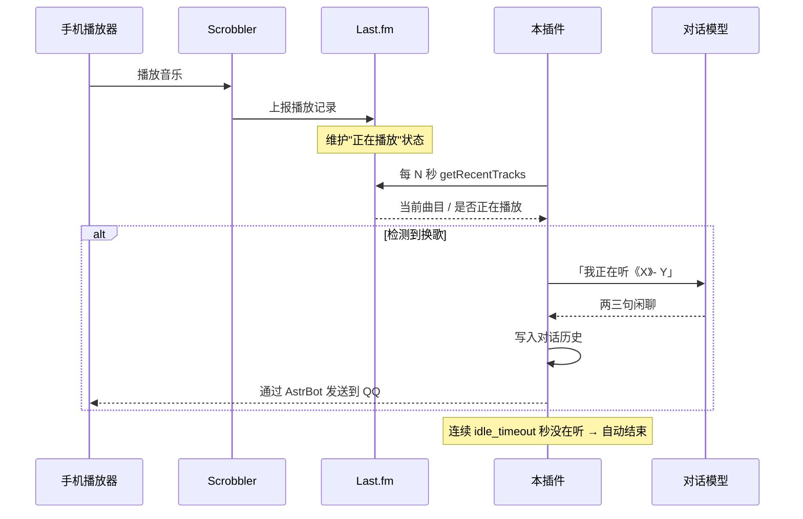
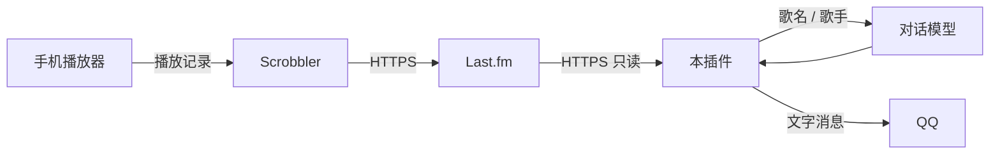

# 陪我听歌 · astrbot_plugin_listen_with_me

[](https://www.gnu.org/licenses/agpl-3.0)
[](https://github.com/AstrBotDevs/AstrBot)

一个 AstrBot 插件：你在手机上听歌，它在 QQ 里陪你。

说一句「陪我听会儿歌」，机器人会通过 [Last.fm](https://www.last.fm) 持续感知你正在听什么，换歌时用朋友的口吻搭一句话；连续一段时间检测不到你在听，会自动收工。

> 它不播放音乐、不下载音频、不需要你登录任何音乐平台的账号。它只是「知道你此刻在听什么」。

---

## 效果

```
你：最近工作有点累
Bot：辛苦了，是那种一直没停下来的累，还是心里有事压着的那种？

你：陪我听会儿歌
Bot：好，我陪你听。换歌了我会说一句，想聊现在这首随时问我。
Bot：刚才还在说累，这会儿切到这首慢的，正好配得上那个心情——像终于坐下来，什么都不用想。

（你切到下一首）

Bot：这个鼓点一进来就亮了，比刚才那首提神，适合把情绪往外甩一甩。

你：这首叫什么来着？
Bot：《XXX》- YYY，专辑是 ZZZ。刚才说的那个鼓点就是开头这段。

（十分钟没再放歌）

Bot：好像有一阵没在听了，我先歇着。想听随时喊我。
```

注意第三句——**它接住了上一轮"累"的话题**，而不是凭空夸一句歌。这是本插件和普通"点歌播报"最大的区别。

---

## 工作原理



三个关键点：

1. **不碰音频**。只读 Last.fm 的曲目元数据（歌名、歌手、专辑）。
2. **换歌才说话**。同一首歌不重复，避免刷屏。
3. **会记住自己说过什么**。搭话会写进 AstrBot 的对话历史，所以你接着回「这首真好听」时，上下文是连贯的。

### 它怎么做到"不掉线出戏"

单纯定时播报歌曲名，听起来会很割裂。本插件用了三处配合，让音乐信息融进对话：

| 机制 | 作用 |
| --- | --- |
| **带上下文生成** | 主动搭话时读取最近 `context_messages` 条聊天记录一并交给模型，让它接着你们正在聊的话题说，而不是从零开始夸歌 |
| **动态上下文注入** | 陪听期间，每轮对话都会通过 `on_llm_request` 钩子注入「用户此刻正在听：X」，模型随时知道你在听什么 |
| **按需查询工具** | 注册 `get_now_playing` 工具，你问「我在听什么」「刚那首叫什么」时，模型会实时查 Last.fm 再回答 |

---

## 前置条件

| 项目 | 要求 |
| --- | --- |
| AstrBot | `>= 4.14`（更早的版本缺少 `conversation_manager` 相关接口） |
| Python | `>= 3.12`（跟随 AstrBot 要求） |
| Last.fm 账号 | 免费注册 |
| Scrobbler App | 手机端，负责把播放记录推给 Last.fm |
| 对话模型 | 需要在 AstrBot 里配好可用的模型提供商 |

### scrobbler 的平台差异

这是**整个方案能否成立的前提**，请先确认：

| 手机系统 | 网易云音乐 | Apple Music | QQ 音乐 / 其他 |
| --- | --- | --- | --- |
| **Android** | ✅ Pano Scrobbler 可抓 | ✅ | ✅ 多数可抓 |
| **iOS** | ❌ 系统限制，基本不可行 | ✅ QuietScrobble / Finale 等 | 视 App 而定 |

iOS 上第三方 App 无法读取其他 App 的播放状态，因此**只有 Apple Music 这类能通过系统 API 暴露播放信息的场景可用**。

Android 推荐 [Pano Scrobbler](https://github.com/kawaiiDango/pano-scrobbler)（开源免费）。

---

## 安装

### 第 1 步：注册 Last.fm 并接上 scrobbler

1. 注册 [Last.fm](https://www.last.fm)，记下用户名（主页地址 `https://www.last.fm/user/xxx` 中的 `xxx`）。
2. 手机上安装 scrobbler，在 App 内授权登录 Last.fm。
3. Android 需要在系统设置里给 scrobbler **「使用情况访问权限」**，否则抓不到别的播放器。
4. 部分系统的省电策略会杀掉后台 App，把 scrobbler 加入「不受限制」名单。

### 第 2 步：验证 scrobbler 真的在工作

打开手机放一首歌，等 1～2 分钟，然后：

- 刷新你的 Last.fm 主页，应该出现 **Now Playing** 或刚 scrobble 的记录；
- 或者直接用浏览器打开下面这个地址（把两处占位符换掉）：

```
https://ws.audioscrobbler.com/2.0/?method=user.getrecenttracks&user=你的用户名&api_key=你的KEY&format=json&limit=1
```

返回的 JSON 里 `recenttracks.track[0]["@attr"]["nowplaying"]` 为 `"true"` 即表示正在播放。

> ⚠️ **这一步没通，后面的配置全部无效。** 插件只是去读 Last.fm，Last.fm 没数据就读不到。

### 第 3 步：申请 Last.fm API Key

1. 打开 https://www.last.fm/api/account/create
2. 按下表填写（这些字段只用于 OAuth 网页授权，本插件用不到，填能过校验的值即可）

| 字段 | 建议填法 |
| --- | --- |
| Contact email | 你的邮箱 |
| Application name | `AstrBot Listen With Me` |
| Application description | `Personal bot plugin that reads my recent tracks to chat about the music I'm playing.` |
| Callback URL | 留空；若必填则 `http://localhost` |
| Application homepage | 留空；若必填则 `http://localhost` |

3. 提交后会显示 **API key**（32 位字符串）和 **Shared secret**。
4. **只需要 API key**，shared secret 请忽略——本插件不做签名请求，不需要它。

### 第 4 步：放入插件目录

把整个 `astrbot_plugin_listen_with_me` 文件夹放进 AstrBot 的插件目录：

```
<AstrBot 根目录>/data/plugins/astrbot_plugin_listen_with_me/
├── main.py
├── metadata.yaml
├── _conf_schema.json
├── requirements.txt
├── README.md
└── LICENSE
```

⚠️ 常见错误：多套一层目录（`.../astrbot_plugin_listen_with_me/astrbot_plugin_listen_with_me/main.py`），或者把文件直接散放在 `plugins/` 下。**`main.py` 必须正好在插件文件夹的第一层。**

AstrBot 根目录位置参考：

| 部署方式 | 常见根目录 |
| --- | --- |
| AstrBot Desktop（Windows） | `C:\Users\<用户名>\.astrbot` |
| 源码部署 | 启动时的工作目录，或 `ASTRBOT_ROOT` 指向的目录 |
| NapCatQQ Desktop 托管的实例 | Desktop 的「应用端」页面查看实例路径 |
| Docker | 容器内 `/AstrBot`，对应挂载出来的目录 |

不确定的话，找 `data/config/cmd_config.json`，它的上两级就是根目录。

### 第 5 步：安装依赖并加载

`aiohttp` 是 AstrBot 的既有依赖，通常无需额外安装。如果启动时报 `ModuleNotFoundError: aiohttp`：

```bash
pip install -r requirements.txt
```

然后重启 AstrBot，或在 WebUI「插件」页重载插件。

**验证加载成功**：日志中出现

```
Loading plugin astrbot_plugin_listen_with_me ...
[陪我听歌] 插件已加载
```

且**没有** `Failed to load metadata` 的警告。

### 第 6 步：填写插件配置

WebUI →「插件」→ 找到「陪我听歌」→ 配置：

| 配置项 | 必填 | 说明 |
| --- | --- | --- |
| `lastfm_user` | ✅ | 你的 Last.fm 用户名 |
| `lastfm_api_key` | ✅ | 第 3 步拿到的 API key |
| `poll_interval` | | 轮询间隔秒数，默认 `90`，建议 60～120 |
| `context_messages` | | 主动搭话时携带的聊天条数，默认 `12`；设 `0` 则不带上下文（不推荐） |
| `idle_timeout` | | 多久没在听就自动结束，默认 `600`（10 分钟） |
| `only_private_chat` | | 默认 `true`，只响应私聊 |
| `allowed_users` | | 用户 ID 白名单，留空不限制 |
| `system_prompt` | | 搭话用的人格提示，留空用内置默认值 |

配置会被 AstrBot 保存在：

```
data/config/astrbot_plugin_listen_with_me_config.json
```

> 该文件中的 API key 是**明文**。`secret: true` 只影响 WebUI 的输入框遮罩，不做加密。详见下方「安全须知」。

### 第 7 步：测试

在 QQ 里私聊机器人：

```
陪我听会儿歌
```

- 立刻返回欢迎语 → 说明插件运行正常
- 提示「还差配置」→ 配置没保存或没生效
- 几秒内说出一句关于当前歌曲的话 → 全链路打通

---

## 使用

### 触发词

| 动作 | 说法（包含任意一个即可） |
| --- | --- |
| 开始陪听 | `陪我听` / `一起听歌` |
| 结束陪听 | `不听了` / `别放了` / `结束陪听` / `不用陪了` |

### 行为说明

| 场景 | 行为 |
| --- | --- |
| 换到新歌 | 结合最近聊天记录生成一句话并发送（同一首歌不会重复） |
| 你问「我在听什么」「刚那首叫什么」 | 模型调用 `get_now_playing` 工具实时查询 Last.fm 后回答 |
| 陪听期间的一般对话 | 每轮请求自动注入当前曲目，模型知道你在听什么 |
| 暂停 / 停止播放 | 不说话，开始计时 |
| 连续 `idle_timeout` 未检测到播放 | 发一句结束语并自动退出 |
| 网络请求失败 | 静默跳过，**不计入**空闲时间，避免误判 |
| 会话中再次发送触发词 | 提示「已经在陪你听了」 |
| AstrBot 重启 | 陪听状态丢失，需重新触发（状态只存在内存） |

---

## 数据流向与隐私



请在使用前明确知道这四件事：

1. **歌名和歌手会发送给你的对话模型提供商。**
   如果用的是 DeepSeek / OpenAI 等云端模型，你的收听内容会离开本机。想避免外发，可把 AstrBot 的对话模型换成 Ollama 等本地模型。

2. **搭话内容会被写入 AstrBot 的对话历史。**
   这是为了让后续对话连贯（你回「这首真好听」它才接得上）。这些内容会进入 AstrBot 的数据库，也会进入你的备份。

3. **Last.fm 上的收听记录默认是公开的。**
   可在 Last.fm 设置里把「最近收听」改为仅自己可见；但注意公开可见是 API 能读取的前提之一，改私密请先在账号设置中确认 API 仍可访问。

4. **插件只主动向外发请求，不监听任何端口。**
   它不会接受外部连接，也不提供任何 HTTP 接口。

---

## 安全须知

发布与部署时请务必注意以下几点。

### 1. API Key 的存储

- 配置以**明文 JSON** 保存在 `data/config/` 下。
- WebUI 里的「密码框」只是界面遮罩（`secret: true`），**不加密文件内容**。
- 因此：**不要把这个配置文件、或整个 `data/` 目录提交到公开仓库**。仓库已提供 `.gitignore` 参考。
- Last.fm 的 API key 只能读取公开数据，泄露的危害有限；但请仍然按凭据对待。

### 2. 不要使用账号密码或 session key

本插件只需要 **API key**。任何要求你填入 Last.fm 账号密码、`session key` 或 cookie 的改版都应视为可疑。本插件不实现、也不需要写操作（scrobble / love / 关注），因此不存在被用来操纵你账号的能力。

### 3. 权限控制

默认 `only_private_chat: true`，即**群里发触发词不会生效**。

原因：如果机器人在公开群里，任何人都能触发它，它就会把你的收听记录公之于众。如果你确实需要在群里使用，请同时配置 `allowed_users` 白名单，仅允许自己的账号触发。

### 4. 日志

插件不会把 API key 写入日志（网络异常只记录异常类型）。如果你修改代码，请保持这一点。

### 5. 部署环境

- 不要将 AstrBot 的 WebUI 或 NapCat 的 WebUI 直接暴露在公网，使用本机访问或 SSH 隧道。
- 插件本身不需要任何入站端口。

### 6. 频率与风控

`poll_interval` 不要设置得过小（建议 ≥ 60 秒）。高频轮询既可能触发 Last.fm 的限流，也会让你在 QQ 侧的主动消息频率异常，增加账号被风控的可能。

---

## 已知限制

| 限制 | 说明 |
| --- | --- |
| 无法识别「正在播放」的精确进度 | Last.fm 只提供曲目与播放状态，没有播放位置 |
| 同一首歌重复播放不会再次搭话 | 以「歌名 + 歌手」作为去重键 |
| 重启后状态丢失 | 陪听状态仅存于内存，未持久化 |
| 多设备同时播放 | 以 Last.fm 的最近一条记录为准，可能来回跳 |
| 冷门歌曲信息有限 | 只把歌名和歌手交给模型，模型对冷门曲目可能了解不多 |
| 歌词不可靠 | 插件不提供歌词，模型凭记忆说歌词容易编造，故人格中明确禁止 |
| 注入的曲目可能滞后 | 每轮注入用的是轮询缓存，最多滞后一个 `poll_interval`；你主动问「我在听什么」时会走工具实时查询，不受此限 |

---

## 故障排查

| 现象 | 可能原因 | 处理 |
| --- | --- | --- |
| 插件列表里看不到 | 目录层级错误 / 元数据校验失败 | 检查 `main.py` 是否在插件文件夹第一层；查看日志中 `Failed to load metadata` |
| `Failed to load metadata ... author 必须是非空字符串` | `metadata.yaml` 的 `author` 为空 | 填一个非空值后重启 |
| 提示「还差配置」 | 配置未保存 | 重新填写并保存，重启 AstrBot |
| 触发后一直不说话 | Last.fm 没有「正在播放」数据 | 用第 2 步的 URL 直接验证 |
| 报 403 / 401 | API key 错误 | 重新核对 key，注意不要带空格 |
| 群里发了没反应 | `only_private_chat` 为 `true` | 改为私聊，或关闭该选项并配置白名单 |
| 说的内容和歌无关 | 模型幻觉 | 检查 `system_prompt`，或换更强的模型 |
| 日志出现 `请求 Last.fm 失败` | 网络到 `ws.audioscrobbler.com` 不通 | 配置代理，或检查 DNS |

---

## 版权与许可

### 本插件

本插件以 **GNU Affero General Public License v3.0 or later（AGPL-3.0-or-later）** 发布，详见 [LICENSE](./LICENSE)。

你可以：

- 自由使用、修改、分发本插件，包括商业环境；
- 把它装在自己的机器人上运行，无需公开任何东西。

你需要：

- 分发时保留版权声明与许可声明，并附带完整的许可证全文；
- 如果你修改了本插件并**将其作为网络服务对外提供**，必须以 AGPL-3.0-or-later 公开你修改后的源代码。

> 简单说：自己怎么用都行；改了给别人用（尤其是做成在线服务），就得把改动也开源。

### 为什么选择 AGPL

AstrBot 本体以 **AGPL-3.0-or-later** 发布，本插件通过其插件 API 运行并 `import` 其运行时模块。

采用与宿主一致的许可证，可以避免"本插件是否构成 AstrBot 的衍生作品"这一认定上的不确定性，也符合 AGPL 保护社区回馈的初衷。

这是本仓库在许可证选择上的主动决定，而非被动要求——**在 AstrBot 插件生态中，MIT 也是常见且被接受的选择**，本项目的早期版本同样使用 MIT。

### 第三方依赖

| 组件 | 许可 | 说明 |
| --- | --- | --- |
| [AstrBot](https://github.com/AstrBotDevs/AstrBot) | **AGPL-3.0-or-later** | 本插件运行于其插件 API 之上 |
| [aiohttp](https://github.com/aio-libs/aiohttp) | Apache-2.0 | 异步 HTTP 客户端 |
| [Last.fm API](https://www.last.fm/api) | Last.fm API Terms of Service | 数据来源 |

> 以上许可信息仅供参考，**不构成法律意见**。用于商业场景前请咨询专业人士。

### 商标与非官方声明

- **Last.fm** 是 Last.fm Ltd. 的商标。本项目为个人开发的第三方工具，**与 Last.fm 官方无任何关联，未获其背书或赞助**。
- **AstrBot** 的版权归 AstrBotDevs 所有。本项目为社区第三方插件，**非 AstrBot 官方项目**。
- **QQ / 腾讯** 相关名称与商标归腾讯公司所有。本项目**不提供、不分发**任何 QQ 协议端（如 NapCat、Lagrange 等），也不包含任何腾讯的私有协议实现。

### 音乐内容

本插件**不下载、不缓存、不分发、不转码任何音频文件**，不提供任何试听或下载能力，不绕过任何数字版权管理（DRM）措施。

它读取的仅是 Last.fm 上**公开的曲目元数据**（歌名、歌手、专辑名、播放状态）。

### 合规提示

- 通过第三方协议端接入 QQ 可能违反腾讯的用户协议，存在账号被限制的风险，**请自行评估并承担**。
- 使用 Last.fm API 需遵守其 [API Terms of Service](https://www.last.fm/api/tos)，包括但不限于不得高频滥用、不得转售数据。
- 请遵守你所在地区关于个人信息与数据保护的法律法规。

---

## 免责声明

本软件按「现状（AS IS）」提供，不附带任何明示或暗示的担保，包括但不限于对适销性、特定用途适用性和非侵权性的担保。

作者不对因使用或无法使用本软件而产生的任何直接或间接损失承担责任，包括但不限于：数据丢失、账号被限制或封禁、服务中断、模型输出内容引发的纠纷。

**使用本软件即表示你已阅读并同意上述条款。**

---

## 更新日志

### v1.1.0

- **主动搭话改为带上下文生成**：读取最近 `context_messages` 条聊天记录，接得上正在聊的话题，不再自顾自夸歌
- **新增 `get_now_playing` 工具**：随时可以问「我在听什么」「刚才那首叫什么」
- **新增动态上下文注入**：陪听期间每轮对话都知道当前曲目
- 新增配置项 `context_messages`
- 对老版本 AstrBot 做了降级处理：`TextPart` 不可用时仅跳过注入，其余功能不受影响

### v1.0.0

- 首次发布
- 支持「陪我听」触发词与「不听了」结束
- 基于 Last.fm `user.getrecenttracks` 的换歌检测
- 连续无播放自动结束
- 默认仅私聊响应，支持用户白名单
- 搭话写入对话历史，保证后续对话连贯

### 许可变更

- **v1.1.0 起**，本项目许可证由 MIT 变更为 **AGPL-3.0-or-later**，与 AstrBot 本体保持一致。
- v1.0.0 若曾以 MIT 分发，该历史版本仍适用其当时的 MIT 许可；变更仅对 v1.1.0 及之后生效。

---

## 致谢

- [AstrBot](https://github.com/AstrBotDevs/AstrBot) —— 插件运行框架
- [Pano Scrobbler](https://github.com/kawaiiDango/pano-scrobbler) —— Android 端开源 scrobbler
- [Last.fm](https://www.last.fm) —— 播放数据接口

---

## 贡献

欢迎提 Issue 与 PR。提交前请确认：

1. 不在代码或日志中输出 API key；
2. 不新增任何音频下载/分发能力；
3. 保持「默认仅私聊」的安全默认值；
4. 遵循现有代码风格。

提交 PR 即表示你同意以 **AGPL-3.0-or-later** 授权你的贡献（inbound = outbound），与本项目许可保持一致。
